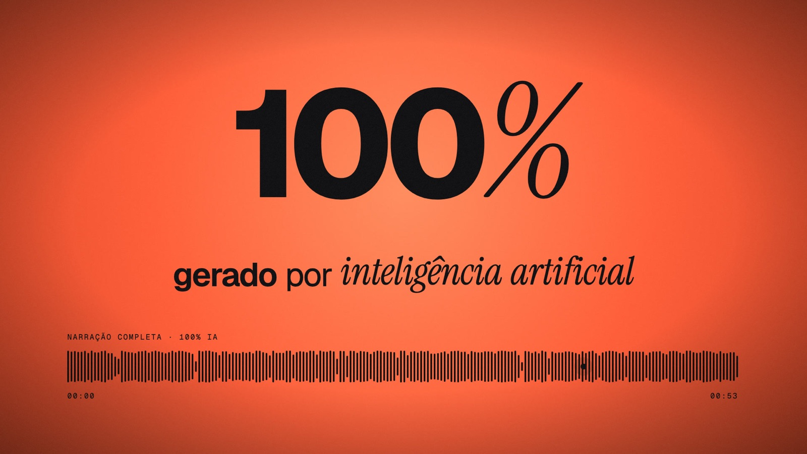
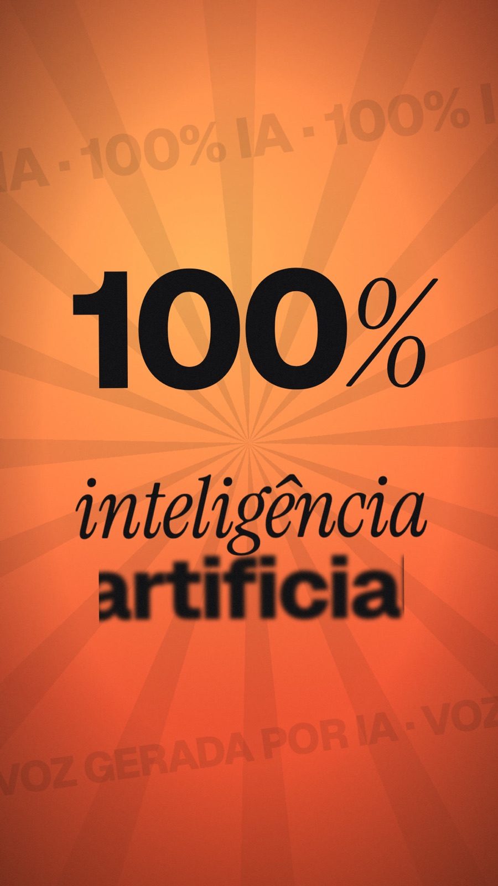
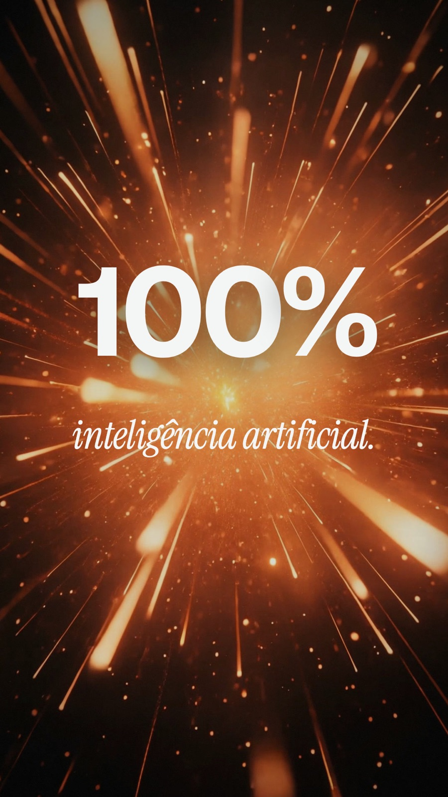

<div align="center">

# Voice Studio

**Atendimento com voz humana para o comércio — e um filme de lançamento feito inteiramente em código.**




</div>

---

## Sumário

- [A dor](#a-dor)
- [De onde veio a ideia](#de-onde-veio-a-ideia)
- [A solução](#a-solução)
- [O que tem neste repositório](#o-que-tem-neste-repositório)
- [Como funciona](#como-funciona)
- [Como eu construí](#como-eu-construí)
- [Arquitetura](#arquitetura)
- [Rodando localmente](#rodando-localmente)
- [Assets e licenças](#assets-e-licenças)
- [Segurança](#segurança)
- [Roadmap](#roadmap)

---

## A dor

Comércio pequeno e médio perde venda no atendimento — não no produto.

- **O cliente chama e ninguém responde.** Mensagem no WhatsApp às 22h, ligação na hora do almoço, pergunta no direct durante o pico da loja. Cada minuto sem resposta é um cliente que fecha com o concorrente.
- **Escalar equipe é caro.** Cobrir todos os canais o dia inteiro exige gente em turno, treinamento e rotatividade que a maioria dos lojistas não consegue bancar.
- **Os robôs disponíveis afastam o cliente.** URA de "digite 1", chatbot de menu e voz sintética travada passam a sensação de descaso. O cliente percebe na hora que está falando com uma máquina e desliga.
- **Mostrar um produto de voz é difícil.** Explicar que "a voz é natural" em texto não convence ninguém. E produzir um vídeo de lançamento com agência custa caro, demora semanas e qualquer ajuste no roteiro vira retrabalho.

## De onde veio a ideia

Eu vi que a tecnologia de voz já tinha chegado num ponto em que é difícil distinguir uma fala gerada de uma gravação real — mas as soluções que chegavam ao lojista ainda soavam como robô. A pergunta que me moveu foi:

> *E se o assistente da loja atendesse com a voz da própria equipe, em qualquer canal, a qualquer hora — e o cliente simplesmente não notasse a diferença?*

A partir daí surgiu a segunda ideia: a melhor prova de que a voz é natural é **fazer o próprio vídeo de apresentação com ela**. O filme guarda uma virada — aos 38 segundos o narrador revela que tudo o que você ouviu até ali foi gerado, com a minha voz, sem eu gravar uma palavra.

## A solução

**Voice Studio** é um assistente para comércio que atende clientes **por mensagem, WhatsApp, voz e telefone**, falando com a **voz de uma pessoa real da equipe**, o dia inteiro, sem perder venda.

Para apresentar o produto construí duas peças:

1. **Um filme de lançamento orientado pelo áudio**, em três formatos, onde cada palavra, corte, som e movimento de câmera é amarrado ao timestamp exato da narração. Mudou o roteiro? Gera a voz de novo, realinha e o filme inteiro se reorganiza sozinho.
2. **Um protótipo de agente de voz ao vivo**, com escuta contínua e interrupção natural (você fala por cima e ele para, escuta e continua sabendo onde parou).

## O que tem neste repositório

| Peça | Formato | Descrição |
|---|---|---|
| `VoiceStudioFilm` | 1920×1080 · 60 fps · ~57 s | Filme principal, motion design editorial em 12 cenas |
| `VoiceStudioStories` | 1080×1920 · 60 fps | Versão vertical para Stories/Reels, sound design mais denso |
| `VoiceStudioCinema` | 1080×1920 · 60 fps | Versão cinematográfica com footage e cenas reais |
| `voice-agent/` | Web (Vite) | Agente de voz em tempo real (ElevenLabs Agents + OpenRouter) |

<div align="center">

&nbsp;

</div>

## Como funciona

A narração é o roteiro. Tudo no vídeo é derivado dela.

```
 voz (.mp3)
    │
    ▼
 1. Transcrição ─────────── whisper.cpp (large-v3-turbo + DTW)
    │
    ▼
 2. Alinhamento forçado ─── wav2vec2 MMS_FA → src/data/words.json  (início/fim de cada palavra)
    │
    ▼
 3. Produção de áudio ───── edição da trilha no tempo da fala, ducking, SFX sintetizados,
    │                       envelopes de energia por frame → public/audio + src/data/*.json
    ▼
 4. Composição ──────────── Remotion: cenas, SFX e trilha referenciam ÍNDICES DE PALAVRAS
    │
    ▼
 5. Render + master ─────── H.264 CRF 16 → loudnorm 2-pass (-14 LUFS / -1 dBTP) → poster
```

Como as cenas apontam para palavras (e não para frames fixos), **retimar o filme é só realinhar a voz**: `timeline.ts`, `sfx.ts` e a edição da música acompanham automaticamente.

## Como eu construí

**Direção criativa antes do código.** Escrevi uma *production bible* ([`docs/design/production-bible.md`](docs/design/production-bible.md)) com conceito, paleta narrativa, tipografia, grid, storyboard e sistema de movimento. O fio condutor visual é a **Linha de Voz**: a forma de onda real da narração, que nasce de um ponto, vira a logo, vira a nota de voz no chat, vira a ligação e se condensa de novo na marca no final.

**Dados separados da apresentação.** Componentes não sabem em que segundo acontecem. Eles recebem índices de palavras e âncoras nomeadas (`anchors.json`), e `motion/time.ts` converte isso em frames. Isso deixou o projeto fácil de iterar e de reaproveitar em três formatos diferentes.

**Determinismo total.** Tudo é função pura do frame: aleatoriedade com `random(seed)`, ruído com `@remotion/noise`, grão de filme pré-gerado em tiles com seed. O mesmo commit sempre renderiza o mesmo vídeo.

**Áudio como sistema, não como trilha de fundo.**
- A música é reeditada no tempo da fala: o *downbeat* do groove cai exatamente na palavra "Voice", há um filtro passa-baixa em "E para te provar", silêncio total em "esse áudio…" e o drop volta no "100%".
- SFX tonais são **sintetizados em Dó maior** (o tom da trilha) direto em Python, para nunca brigarem com a música.
- *Side-chain ducking* e corte de médios sob a voz, para a narração sempre ter prioridade.
- Envelopes de energia da voz e do grave são pré-computados por frame — a luz da cena "respira" com o áudio sem nenhuma análise em tempo de render.

**Pipeline de QA.** `scripts/stills.mjs` renderiza frames específicos e monta uma folha de contato rotulada; `scripts/audio-qa.sh` checa loudness e espectro. Cada cena foi revisada em stills de meio de transição e com checagem de sincronia frame a frame (início da palavra vs. primeiro frame visível).

**Agente de voz.** O protótipo usa ElevenLabs Agents para voz, escuta e interrupção, com o LLM plugado via OpenRouter (qualquer modelo). As chaves ficam **só no servidor** (middleware do Vite); o navegador recebe apenas um token WebRTC de sessão.

### Stack

| Camada | Tecnologias |
|---|---|
| Vídeo | Remotion 4, React 19, TypeScript, `@remotion/transitions`, `@remotion/paths`, `@remotion/noise` |
| Áudio | Python 3.12 (NumPy, SciPy, pyloudnorm, soundfile), FFmpeg |
| Fala | whisper.cpp, torchaudio wav2vec2 MMS_FA, ElevenLabs |
| Agente | ElevenLabs Agents (WebRTC), OpenRouter, Vite |
| Tipografia | Geist, Geist Mono, Geist Pixel, Instrument Serif |

## Arquitetura

```
src/
├── Root.tsx                 registro das 3 composições
├── compositions/            VoiceStudioFilm: Backdrop → TransitionSeries → overlays → Soundtrack
├── scenes/                  S01Hook … S12Outro
├── stories/                 versão vertical (cenas, timeline e SFX próprios)
├── cinema/                  versão cinematográfica (shots, kit, transições)
├── data/                    words.json · anchors.json · envelopes · timeline.ts · sfx.ts
├── theme/                   tokens (cores, tipo, grid) · fontes
├── motion/                  easing · springs · time (wordFrame, progress)
├── typography/              KineticPhrase · Glitch
├── components/              VoiceLine · Logo · Lockup · UI
├── backgrounds/             Backdrop (ink + light pool + grão + vinheta)
├── transitions/             lift · whip · plusWipe · dip · iris · collapse
└── audio/                   Soundtrack (voz, trilha, cues de SFX)

scripts/
├── align.py                 alinhamento forçado → words.json
├── build_audio*.py          produção de áudio por formato
├── master*.sh               render → master de loudness → poster → entregáveis
├── stills.mjs               folhas de contato para QA
└── audio-qa.sh              loudness e espectro

voice-agent/                 agente de voz em tempo real
docs/design/                 production bible
```

## Rodando localmente

**Pré-requisitos:** Node 20+, FFmpeg, [uv](https://github.com/astral-sh/uv) e, para regerar a transcrição, [whisper.cpp](https://github.com/ggerganov/whisper.cpp).

```bash
npm install
npm run dev            # Remotion Studio com as 3 composições
```

Pipeline completo (a partir de uma nova narração em `work/audio/`):

```bash
# 1. transcrição
whisper-cli -m ~/.cache/whisper-cpp/ggml-large-v3-turbo.bin -f work/audio/voice-16k.wav \
  -l pt -ojf -nfa -dtw large.v3.turbo -of work/transcript/turbo

# 2. alinhamento palavra a palavra
uv run --python 3.12 scripts/align.py work/audio/voice-16k.wav work/transcript/transcript.txt src/data/words.json

# 3. produção de áudio (trilha, ducking, SFX, envelopes)
AUDIO_ASSETS_DIR=./assets uv run --python 3.12 scripts/build_audio.py

# 4. render + master + entregáveis → out/
scripts/master.sh            # ou master-stories.sh / master-cinema.sh
```

QA: `node scripts/stills.mjs <nome> <frame> [frame…]` gera uma folha de contato em `work/stills/<nome>.jpg`.

### Agente de voz

```bash
cd voice-agent
cp .env.example .env   # preencha ELEVENLABS_API_KEY, OPENROUTER_API_KEY, modelo e voz
npm install
npm start              # abre o navegador e já começa a escutar
```

Use o Chrome (cancelamento de eco nativo, funciona sem fone).

## Assets e licenças

- **Trilha:** *Happy Beats / Business Moves vol. 12* — ende.app. Por ser licenciada, a faixa original e os `music-bed.wav` derivados **não são versionados**. Coloque a faixa em `assets/music/` (ou aponte `AUDIO_ASSETS_DIR`) e rode `build_audio.py` para regerar.
- **SFX:** Kenney.nl (CC0) + sound design sintetizado em `scripts/build_audio.py`.
- **Fontes:** Geist, Geist Mono, Geist Pixel, Instrument Serif (Google Fonts, OFL).
- **Código:** todos os direitos reservados.

## Segurança

- Nenhuma credencial é versionada: `.env` e `.state.json` estão no `.gitignore`; use `.env.example` como modelo.
- No agente de voz, as chaves de API nunca chegam ao navegador — o servidor troca as credenciais por um token de sessão de curta duração.

## Roadmap

- [ ] Integração com WhatsApp Business API e telefonia (SIP)
- [ ] Catálogo da loja como base de conhecimento do agente
- [ ] Painel do lojista com histórico de conversas e vendas atribuídas
- [ ] Geração do filme por template: nova narração → vídeo pronto em todos os formatos

---

<div align="center">

Desenvolvido por **Ruan Pablo**

</div>
